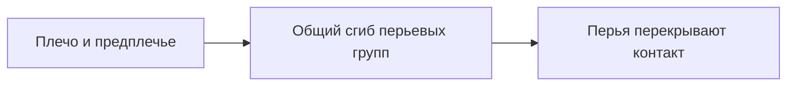

# Двухчастные перьевые группы без человеческой кисти

По уточнениям автора сова не вращает предметы запястьем, не перелистывает
страницы пальцами и не нуждается в плотном зажиме: контакт скрывают перья.
Текущий результат — [v3](report-v3.md), [инструкции и видео](README.md).

Две части сохранены как упрощённая конструкция перьевой группы. Это позволяет
согнуть концевое оперение вместе с крылом, но не означает полноценную
манипулирующую человеческую руку.

- `feathersN.L/R → feathersN_tip.L/R`, N=1/2/3, длины частей 55/45%.
- Гибкие основания имеют нормализованные веса, внешние перья остаются жёсткими.
- В текущем тесте основание сгибается совместно на 0,15 радиана, концевая
  часть — на 0,55. Все три концевые группы стороны движутся одинаково.
- `CTRL_wrist.L/R` задают только положение конца крыла. Само запястье
  наследует предплечье; Copy Rotation и отдельные повороты запястья исключены.
- Книга не вращается как целое. Двигается крыло, поднимающее обложку;
  при чтении книга лежит на опоре, а крылья свободны.

Проверяются крупный жест, перьевое перекрытие, сохранение длин и отсутствие
самостоятельной манипуляции пальцами. Точные контактные площадки и физический
зажим не входят в требование автора.

Старые A/B и `finger_curl.mp4` в `v1-grip-study` — историческая демонстрация
сустава, не действующая анимационная механика. Они не заменяют актуальное
`v3-opening-study/opening_side.mp4`, где показано движение крыла и обложки.
