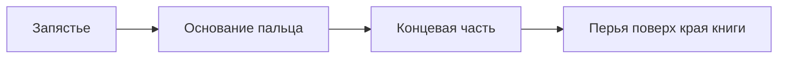

# Двухчастные пальцы для удержания книги

Уточнения автора имеют приоритет над исходной формулировкой Issue:
**две части пальца, без перелистывания, плотный зажим не требуется —
контакт скрывается перьями, перекрывающими книгу**.

## Реализованное решение

Флаг `--articulated-fingers` добавляет к каждой из трёх групп перьев
цепочку **основание → концевая часть**. Получается 23 кости вместо 17.
Это вариант того же персонажа; mesh не меняется между фазами.



- Кости `feathersN.L/R → feathersN_tip.L/R`, N=1/2/3.
- Длины частей — 55/45% от группы; их сумма постоянна.
- Гибкое замкнутое основание имеет нормализованные веса соседних костей.
  Наружные короткие перья остаются жёсткими и перекрывают зоны сгиба.
- В тесте удержания основание сгибается на 0,30 радиана, концевая часть —
  на 1,05. Ограничитель конца: 0…1,4 радиана. При отпускании сгибы исчезают.
- Управление — FK-костями и существующими IK-целями запястий. Новые
  когтистые человеческие руки не добавляются. Перья перекрывают край книги;
  плотное прилегание каждого кончика не является критерием приёмки.

Дополнительный сустав позволяет прочитать зажим без усложнения до полноценной
трёхфаланговой кисти. Проверять нужно силуэт, сгиб, перекрытие книги перьями,
отсутствие заметных скачков и возвращение сложенного крыла.

Blender 4.0 поддерживает ограничения суставов и IK без stretch:
[Bone IK](https://docs.blender.org/manual/en/4.0/animation/armatures/bones/properties/inverse_kinematics.html),
[IK constraint](https://docs.blender.org/manual/en/4.0/animation/constraints/tracking/ik_solver.html).

## Визуальная проверка

Итоговая сцена: `.local-assets/characters/uki/model/v1-review/`.
A/B: `.local-assets/characters/uki/model/v1-grip-study/`:

- `fingers_straight.png` — пальцы распрямлены.
- `fingers_curled.png` — те же пальцы согнуты; книга и остальные кости неподвижны.
- `finger_curl.mp4` — крупный план «разжать → согнуть → разжать».
- `finger-study.json` — технические измерения, не требование плотного контакта.

```bash
blender -b .local-assets/characters/uki/model/v1-review/uki_character_v1.blend \
  -t 4 --python-exit-code 1 --python pipeline/blender/render_finger_study.py -- \
  --output output/finger-study-new
```

Независимая проверка проходит 181 кадр/16 фаз: длины всех 23 костей постоянны,
38 176 рёбер жёстких деталей проверены; максимальное изменение длины
`4,74×10⁻⁷`. Гибкие основания исключены из требования постоянной длины
рёбер, но их веса нормализованы. Non-manifold edges и вырожденных граней нет.
Крупный план предназначен для авторской оценки убедительности жеста.
Физическая симуляция захвата и перелистывание в этот scope не входят.
